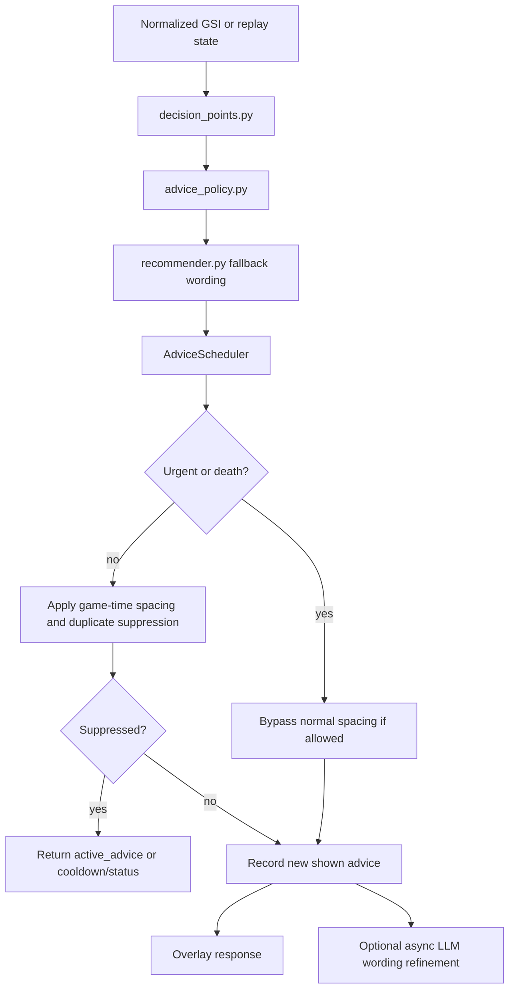

# Advice Scheduler

`backend/app/advice_scheduler.py` is the in-memory anti-spam and display state layer between decision detection and the overlay.

It does not parse Dota data, choose hero builds, call STRATZ, read the screen, read memory, or automate input. It receives a normalized state plus a decision point and returns one of:

- a new advice card;
- the still-active previous advice card;
- a compact cooldown/status response.

## Flow

## Main Responsibilities

- Track match/session resets.
- Count full advice cards separately from status/monitoring responses.
- Keep the last useful card visible while cooldown is active.
- Suppress repeated category/action advice.
- Enforce game-time spacing for normal coaching advice.
- Let urgent safety advice interrupt normal coaching spacing when appropriate.
- Pin death review advice while dead/respawning.
- Suppress repeated low-HP, objective, and post-laning macro messages.
- Record metrics for simulation reports.

## Game-Time Vs Wall-Clock

Decision frequency is based on Dota `game_time` or simulated replay `timestamp_seconds` when available. This matters because replay demos can run at `speed 5`, `speed 10`, or faster, but advice should still feel paced for real gameplay.

Wall-clock time is still used for:

- overlay card visibility/auto-hide;
- HTTP polling;
- async LLM staleness checks.

## Anti-Spam Rules

- Normal coaching advice is spaced by game time, typically at least 45-60 seconds apart.
- Same category/action advice is suppressed for about 120 seconds of game time.
- Objective caution is suppressed for about 150-180 seconds unless context changes meaningfully.
- Post-laning macro cards are suppressed after recent low-HP/death/safety advice.
- Monitoring/status responses do not increment `advice_count`.

## Urgent Interrupt Rules

`LOW_HP` and death review decisions may interrupt normal spacing. Repeated `LOW_HP` states are still grouped into episodes so the overlay does not spam the same urgent warning every few seconds.

## Active Advice

Display hold is separate from advice generation. The backend may return `active_advice` during cooldown so the overlay can keep showing the previous useful card without counting it as a new card.

## Held-Card Validity

A held card is re-checked against every new snapshot (`advice_validity.py`).
Each new card stores a basis: the snapshot's clock and game time, whether the
hero was alive, the tool its action names and the numbers it cites. The card is
withdrawn when the basis no longer holds:

- `life_lost` / `respawned`: the life changed (an Aegis revive included);
- `action_done`: the named item or ability was used (cooldown started, charges
  down, gone);
- `cannot_act_now`: a «now» command while the hero is now stunned/hexed (or
  muted for items); the low-HP episode may then speak again in the fitting form;
- `stale_numbers` / `resolved`: cited buyback gold or cost moved, or the gold
  is back; Magic Wand charges changed;
- `recovered`: HP is back well above the low-HP card's line;
- `not_a_threat`: the disable turned out to be the player's own phase;
- `superseded_by_threat`: a calm card (farm, TP, smoke, item) when an enemy
  disable or a fast HP fall starts.

Withdrawn cards are neither shown nor spoken again: the response carries
`withdrawn_advice` for 10 s and the overlay drops the card and cuts its speech.
An async refinement applies only to the card it was started for. The basis is
returned as `advice_basis` and recorded with each advice line of a match
recording.

Urgent disable cards bypass the post-laning farm-category dedup and the
per-minute quota; a readiness card right after a kill or a revive passes the
type cooldown, coaching spacing and quota once per moment. Generic «keep
farming» lines with no decision are not shown.

## Known Limitations

- The scheduler only uses signals available in the normalized state.
- Statuses, deaths and done actions are inferred from GSI (no modifier names,
  no caster, no combat log): see `status_source.py`, `action_feedback.py` and
  [LIVE_ADVICE_AUDIT.md](LIVE_ADVICE_AUDIT.md).
- It cannot know exact enemy positions, nearby allies/enemies, or team readiness unless those signals are provided.
- Replay-derived GSI-like states may miss cooldowns, spendable gold, and exact objective context.
- The scheduler is intentionally in-memory.
